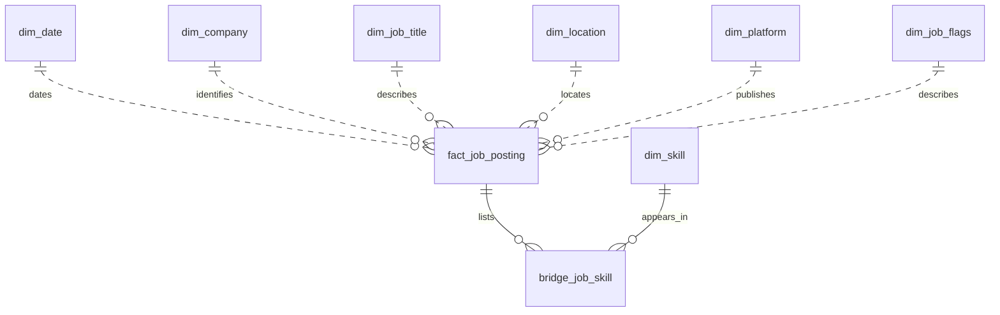

# Job data pipeline

I built this pipeline to take the job postings from the assessment CSV and organize them in PostgreSQL. I keep the original records in staging, validate them, and then load the relational tables.

My main choices are explained in the [decision log](docs/decisions.md). The [ER diagram](docs/er-model.md) shows the relationships, and [schema.sql](sql/schema.sql) defines the tables and constraints.

## Why I chose this setup

I use Python to read and validate the CSV, then SQL to transform the staged records into the relational model. Reading in batches keeps Python's memory use bounded, and COPY lets me load those batches efficiently. The standard CSV module handles the file format, while Psycopg gives me direct control over database transactions.

For the 3NF model, I separate companies, titles, locations, platforms, and skills so I can store their attributes once and reference them through foreign keys. Junction tables handle relationships with several values, such as a job's skills or a skill's categories. I chose those relationships after checking the actual dependencies in the file.

I keep staging because I need to trace a published job back to its original values and inspect failed loads. Publishing a whole file in one transaction keeps partial results out of the completed data. Docker Compose gives me a repeatable PostgreSQL setup with the official image, a readiness check, and persistent storage.

## Running locally

I use Python 3.12 or newer and Docker with Compose. From the repository folder, I set up the Python environment:

```powershell
python -m venv .venv
.\.venv\Scripts\Activate.ps1
python -m pip install -r requirements-dev.txt
Copy-Item .env.example .env
```

Before running the pipeline, I set a password in `.env` and check `INPUT_FILE`. The same file holds the batch size and database settings. Relative input paths start from the folder containing `.env`.

I keep the assessment CSV outside Git. Once it is available at the configured path, I start the database and run the pipeline:

```powershell
docker compose up -d --wait
python -m jobs_pipeline init
python -m jobs_pipeline load
python -m jobs_pipeline check
```

For another environment, I can pass `--env-file path/to/.env` to any command. The database uses a named Docker volume, so its data survives container restarts. PostgreSQL reads its initial user, password, and database settings when that volume is empty. Changing `.env` later does not update those existing database settings.

## How I handle the data

I identify each job record with a SHA-256 fingerprint of all 17 source fields. Skill order and repeated skill names do not change that identity. Every original occurrence stays in `staging.jobs` with its CSV record number.

Before loading a file, I check its content hash. If that file was already completed, I skip it, even when its name has changed. A later file can add new skills, platforms, companies, and other entities as part of the normal load.

I use `skills_reported` to distinguish missing skill information from an explicitly empty list. The actual skills are stored through `job_skills`. Other optional values can stay null when the source does not provide them.

Staging and publication run in separate transactions. If a row is invalid or a classification conflicts with existing data, I keep the staged records and the error, stop the load with exit code 1, and leave the previous published data available. After checking the issue, I can fix the source or rule and run the load again. An interrupted command returns exit code 130.

These queries help me inspect a failed load:

```sql
SELECT file_id, file_name, status, row_count, invalid_count, error
FROM staging.source_files
ORDER BY file_id DESC;

SELECT file_id, record_number, validation_error, raw_record
FROM staging.jobs
WHERE validation_error IS NOT NULL
ORDER BY file_id DESC, record_number
LIMIT 20;
```

## Running the tests

I can run the parsing, configuration, and fingerprint tests without a database:

```powershell
python -m pytest -q -m "not integration"
ruff check jobs_pipeline tests
ruff format --check jobs_pipeline tests
```

For the database tests, I use a separate database with a name ending in `_test`. With the example database user, I create it like this:

```powershell
docker compose exec db createdb -U jobs jobs_test
```

Then I set `TEST_DATABASE_URL` using my own password and connection settings. The tests clear the pipeline tables in that test database.

```powershell
$env:TEST_DATABASE_URL = "host=127.0.0.1 port=5432 dbname=jobs_test user=jobs password='my-local-password'"
python -m pytest -q
```

The cases cover repeated and overlapping files, new entities, missing and empty skills, invalid input, conflicting classifications, and rollback followed by retry. There is also a test for two loads running at the same time. Database tests are skipped when `TEST_DATABASE_URL` is not set.

I run the same lint, formatting, and test checks in [GitHub Actions](docs/github-actions.md), using Python 3.12 and a temporary PostgreSQL database.

## What I checked

I ran the complete file through native PostgreSQL 18.6 in Docker on October 29, 2026. The pipeline used COPY and published 785,637 distinct job records from 785,741 source records, with 104 duplicate occurrences, 3,594,662 job-skill relationships, and no invalid rows. All data-quality checks passed.

I also ran all 33 test cases against this setup: 21 unit cases and 12 database cases, including concurrent writers. Ruff's lint and formatting checks passed. Staging took 198.20 seconds and publication took 320.82 seconds on this PC. I recorded the environment and the earlier embedded-database checks separately in the [decision log](docs/decisions.md).

I repeated the load with batch size 777 and confirmed that it was skipped. I compared all 14 tables before and after that repeat, then restarted the database container and compared them again. Their contents and IDs stayed unchanged, and the quality checks passed after restart.

## Limits of the source

I count distinct source records. Without a listing ID or URL, I cannot reliably count unique real-world vacancies. I also keep the supplied salary values without assuming a currency or filling in missing amounts. Location and classification conflicts need review before I change their meaning.

## Conceptual analytical model

For a BI dashboard, I would build the following star schema from the published 3NF tables. This is a design proposal; the analytical tables are not implemented.

### Fact table and grain

I would use `fact_job_posting`, with one row per distinct source record in `core.jobs`. I would keep `job_id` for tracing the record and make `record_hash` unique so repeated loads cannot add the same fact again. The fact would reference the dimensions below and retain the original posting timestamp. I would count source postings under the same rule I use in the relational model.



### Dimensions

| Dimension | What I would include |
| --- | --- |
| `dim_date` | Posting date, month, quarter, and year. |
| `dim_company` | Company name under the existing identity rule. |
| `dim_job_title` | Full title and standardized title, so I can report by either. |
| `dim_location` | Reported location and country together for easier filtering. |
| `dim_platform` | Platform where the posting appeared. |
| `dim_skill` | One row per skill, connected through `bridge_job_skill`. |
| `dim_job_flags` | Observed combinations of the three source flags and the two skill-presence indicators. |

I would use an `Unknown` member when an optional dimension is missing, while keeping any available detail, such as a known country with a missing location label. I would keep `search_location` separately on the fact as collection context.

### Measures

| Measure | How I would use it |
| --- | --- |
| `posting_count = 1` | Sum it at the fact grain to count postings by date, role, company, location, or platform. |
| `salary_year_avg` | Keep the supplied annual value, including nulls. |
| `salary_hour_avg` | Keep the supplied hourly value separately, including nulls. |
| Salary coverage | Derive the count and percentage of postings with a supplied salary, separately for annual and hourly values. |

I would not sum salaries or replace missing values with zero. Before comparing salaries or calculating averages, I would confirm that their currencies and pay periods are comparable. The source has no currency field, and country alone does not establish one.

### Skills and boolean flags

I would give `bridge_job_skill` one row per distinct job and skill. A posting with Python and SQL would count once under each skill, so skill totals overlap. For a filter covering several skills, I would first select distinct job IDs, then calculate counts and salary metrics from the matching facts. This prevents a bridge join from repeating a posting's salary.

I would use `dim_job_flags` as a junk dimension: one row per observed combination of `job_work_from_home`, `job_no_degree_mention`, `job_health_insurance`, `skills_reported`, and `skill_categories_reported`. For the three nullable source flags, I would preserve true, false, and unknown. The presence indicators would still distinguish missing skill information from an explicitly empty collection, even when neither has bridge rows.

I explain the aggregation rules and possible schedule and category filters in the [analytical design decisions](docs/decisions.md#analytical-model-proposal).
