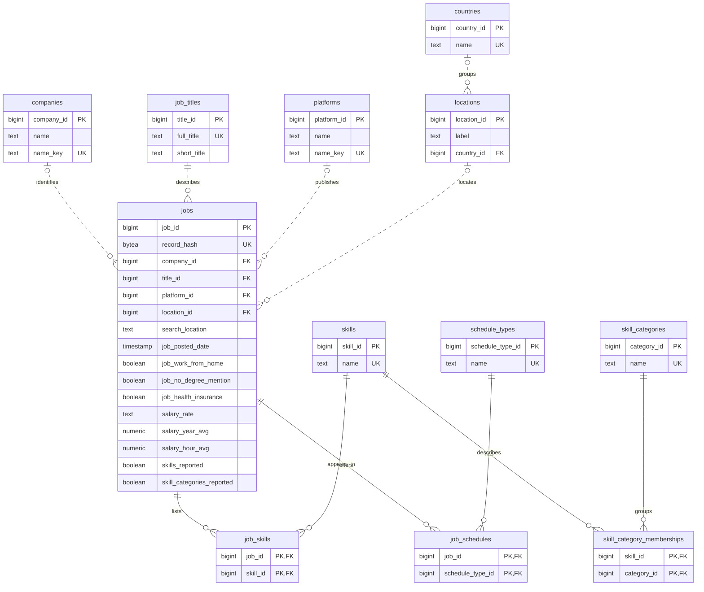

# My relational model

I use this model to separate the main entities and their relationships. The table definitions and constraints are in [schema.sql](../sql/schema.sql). My reasons for the model are in the [decision log](decisions.md).

