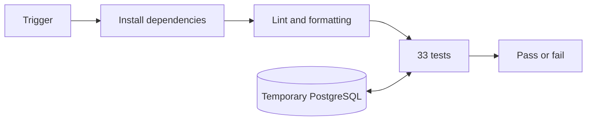

# GitHub Actions

## Triggers

- Pull requests to `main`.
- Pushes to `main`.
- Manual runs from GitHub Actions.

## Environment

| Component | Value |
| --- | --- |
| Runner | GitHub-hosted Ubuntu |
| Python | 3.12 |
| PostgreSQL | `postgres:18.6-bookworm` |
| Database | Temporary `jobs_test` |
| Data | Small CSV files created by the tests |
